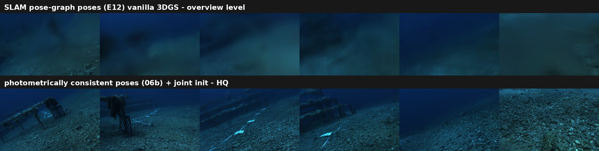

# water — 水下 3D 高斯泼溅建图 · Time-to-Map

> 把水下视频变成可用的 3D 地图，越快越好。免离线 COLMAP，浑水边采集边建图。

上图：普通 SLAM 位姿直接喂 3DGS，画面糊；下图：用光照一致的位姿 + 双输出联合初始化，画面清晰。

  <video src="docs/assets/flythrough_fullseq.mp4" poster="docs/assets/video_poster.jpg" controls width="800"></video>

↑ 整段水下采集视频 · 1017 帧 · 约 100 秒

## 🛰️ DIRECT 深度模型的三个用法

| 用途 | 做法 | 效果 |
|------|------|------|
| **初始化** | 把每帧深度反投影成 3D 点，凑成初始点云 | 免 COLMAP，浑水直接起步 |
| **尺度** | 用深度自动算出实际米制（不用真值） | 轨迹自带绝对尺度 |
| **压缩** | 把"深度多次对得上"的位置当高可信区，门控 densify | 地图可缩 20%，画质不变 |

## 📊 项目核心结果

| # | 结果 | 数字 |
|---|------|------|
| ① | **首张高质量地图耗时** | **698 秒**（170 帧水下视频） |
| ② | **加训练步数时清晰度怎么变** | 锐度 **0.04 → 0.24 → 0.34** |
| ③ | **我们的方案 vs 离线 SfM** | 画质 PSNR **高 4 个 dB**（31.66 vs 27.57）；地图**小 8.6%**（83 万 vs 91 万高斯）；清晰度 **10.56 vs 12.61**（它略高） |

## 🎬 导览

- 🌐 **完整报告页**：<https://poiuyjie.github.io/water/> ——
  系统是怎么搭的 → 主结果 → 在线和离线的对比。
- ▶ **对照：在线 698 秒实时建出来的地图本体**（`flythrough_online_A3.mp4`）

  <video src="docs/assets/flythrough_online_A3.mp4" poster="docs/assets/video_poster_online.jpg" controls width="800"></video>

---

*© 2026 water · Time-to-Map · 项目展示*
